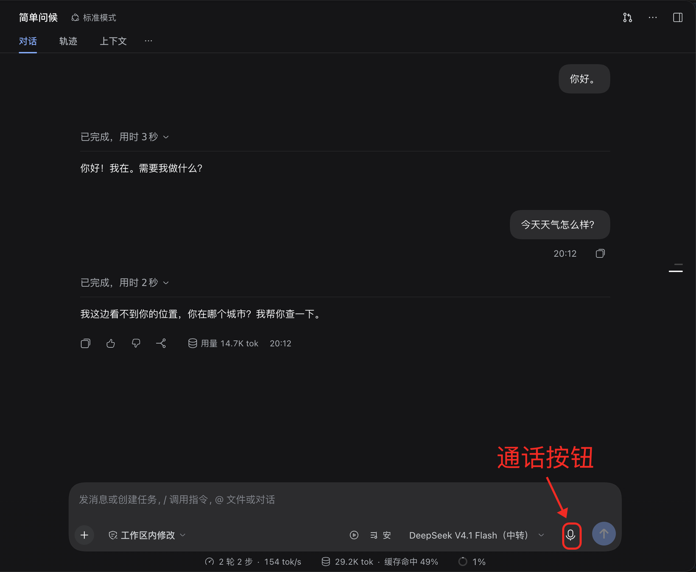
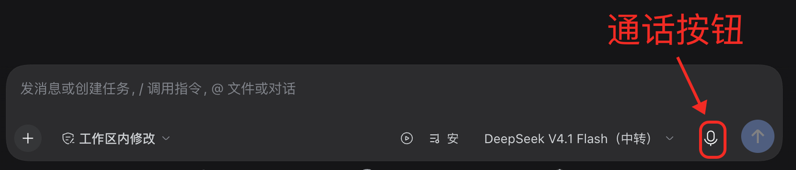
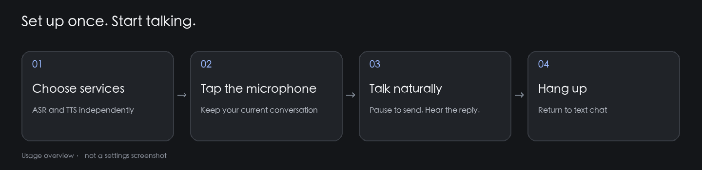

# Voice call · 语音通话

**Speak in your current DSH conversation. Hear your Agent reply.**

Start the microphone, speak, and pause: the plugin transcribes and sends your message, then reads the response aloud. Keep using Standard mode and your conversation’s existing model, tools, and permissions. No separate Agent preset is needed.

[中文指南](README.zh.md) · [npm](https://www.npmjs.com/package/voice-call) · [GitHub](https://github.com/crease123/voice-call) · [Releases](https://github.com/crease123/voice-call/releases)



*Actual usage screenshot, with the entire sidebar removed to exclude workspace names, conversation lists, and account details. The model shown is an example, not a requirement. Screenshots use the Chinese interface.*

## What you can do

| Feature | Experience |
| --- | --- |
| Continuous conversation | Pause after speaking to transcribe and send automatically; hear replies streamed sentence by sentence |
| Interrupt by speaking | Speak over playback to interrupt and ask your next question |
| Mix speech providers | Choose DeepSeek or Doubao independently for recognition (ASR) and synthesis (TTS) |
| Minimal call view | The text editor gives way to five voice bars, status, and a hangup control; microphone volume drives the bars |
| Tune voice and capture | Choose a voice, adjust playback volume, preview speech, and tune interruption sensitivity and minimum speech duration |
| Call-only instructions | Automatically add concise, conversational response guidance during calls and withdraw it afterward; edit the rules in settings |

## Get started in three steps

### 1. Install

Requires **DSH 0.2.2-rc.1 or later in the 0.2.x line**, a microphone, and working audio output.

In DSH, open **Plugins → Add plugin** and add this npm package:

```text
voice-call
```

Check that the source repository is **`crease123/voice-call`** to distinguish it from similarly named projects. Once installed and enabled, the composer should show a microphone, and Settings should include “Voice call” and “Voice call instructions.”

Alternatively, get the prebuilt package from [GitHub Releases](https://github.com/crease123/voice-call/releases) and add its download URL in DSH. There is no need to download or build the source.

<details>
<summary>CLI installation</summary>

```sh
dsh plugin --profile <your-profile> add voice-call
```

Replace `<your-profile>` with your actual profile name. Desktop users should install through the app’s plugin manager.

</details>

> This guide describes v0.3.3 and later, where voice calls work within your existing conversation without a separate Agent preset. Upgrade older installations to use the behavior shown here.

### 2. Configure your speech services

Open **Settings → Voice call**. Select recognition and synthesis services independently. Recognition turns your speech into text; synthesis turns the Agent’s reply into audio. These choices do not replace your conversation’s chat model.

| Provider | What you need | Configuration |
| --- | --- | --- |
| DeepSeek (default) | Your own DeepSeek API key and access/quota for the services | Reuses DSH’s saved `DEEPSEEK_API_KEY`; no duplicate entry in this plugin |
| Doubao / Volcengine | Your own speech credentials and enabled ASR/TTS resources | Under “Doubao API configuration,” enter an **API key**, or a legacy **App ID + Access token**, then Apply |

Either Doubao credential method works; **API key takes priority**. An unconfigured API key does not prevent legacy authentication when both App ID and Access token are configured.

Saved secrets are not displayed again; blank fields preserve existing values. Credentials stay in your DSH Host credential store. The plugin supplies no shared key, author account, or free quota. Your provider account covers speech-service usage charges.

Apply your selections before previewing speech. After switching providers, hang up and start a new call. DeepSeek offers Stella and Tide voices; rate, pitch, and delivery controls apply to Doubao only.

### 3. Tap the microphone and talk

Open an ordinary conversation and click the microphone at the lower right of the composer. On first use, allow microphone access for DSH or your browser. Start speaking when the status says “Listening.”



*Use the microphone marked by the arrow, rather than the Send button to its right.*



Pause after a sentence to transcribe and send it automatically. Hear the Agent’s response while retaining the conversation’s text transcript. Speak to interrupt playback when you need to change direction. Click **Hang up voice call** to return to text input; your unsent text draft is preserved.

## Make it work for you

### Voice, volume, and capture

Use **Settings → Voice call** to adjust:

- **Playback volume**: affects speech in this client only, without changing system volume.
- **Interruption sensitivity**: lower it if background noise interrupts; raise it if quiet speech is missed.
- **Minimum speech duration**: increase it to filter brief noises. Too high a setting may miss very short utterances.
- **Preview**: check the selected voice. Preview temporarily pauses capture and automatic readout in active calls, then resumes them afterward.

Headphones help prevent the microphone from picking up speaker playback.

### Instructions that apply only during calls

Open **Settings → Voice call instructions**, edit the rules, and save. For example:

> Answer the main question first, usually in 1–3 natural sentences. Leave code and long lists in text; speak only the key points.

Saved rules apply to the next model request, without rewriting a response already in progress. They apply to any connected voice conversation and are withdrawn on hangup or disconnect. They do not replace the existing persona, tools, or permissions. The plugin no longer adds a separate Personal Agent / Voice call preset.

## Troubleshooting

| Symptom | Check first |
| --- | --- |
| No microphone after installation | Confirm the plugin is enabled and DSH is compatible; reopen the app |
| Microphone unavailable | Check system/browser permissions and input device; the Web client needs AudioWorklet and a secure browser context |
| Recognition works, but there is no sound | Check TTS credentials, playback volume, and output device; try Preview |
| Playback works, but recognition fails | Check ASR credentials, enabled resources, and connectivity; ASR and TTS may use different providers |
| Noise interrupts too often | Use headphones, lower sensitivity, or increase minimum speech duration |
| Replies remain long | Save your call instructions and confirm the request began after connecting; instructions do not retroactively change an existing generation |
| Work continues after hanging up | Hangup ends the speech connection. Use the conversation’s Stop action to stop Agent work |

Recognition and synthesis depend on network and provider latency. DeepSeek recognition uploads a completed audio segment after each utterance; continuous conversation does not imply word-by-word live transcription.

## Development and architecture

Users only need to install `voice-call`. The main release embeds its three runtime components.

| Internal component | Responsibility |
| --- | --- |
| `voice-speech-doubao` | DeepSeek / Doubao recognition, synthesis, credentials, and speech settings |
| `personal-agent` (legacy internal name) | Session-bound call state and instruction injection; no preset registration, and legacy base-persona settings are ignored |
| `client-ui-voice-conversation` | Recording, utterance detection, playback, interruption, and call UI |
| `voice-conversation-bundle` | Composes the runtime components into one installable plugin |

Source builds require a matching Harness checkout. First run `pnpm run build:artifacts` there, then run in this repository:

```sh
pnpm install
DSH_HARNESS_ROOT=/absolute/path/to/deepseek-harness pnpm run build
```

For local watching, use `pnpm run dev:watch` with the same `DSH_HARNESS_ROOT`. Configure source entries in the profile’s own `cordis.patch.yml` so plugin settings can be persisted. Remote generation temporarily changes Harness build configuration; do not run it alongside other edits to that configuration.

Read more: [Speech subsystem](docs/voice-conversation.md) · [Call context](packages/experimental/personal-agent/README.md) · [Bundle](packages/experimental/voice-conversation-bundle/README.md).

MIT License. Never commit API keys or tokens, or include them in issues or screenshots.
