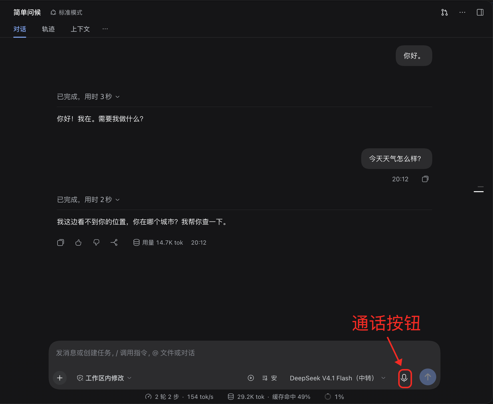
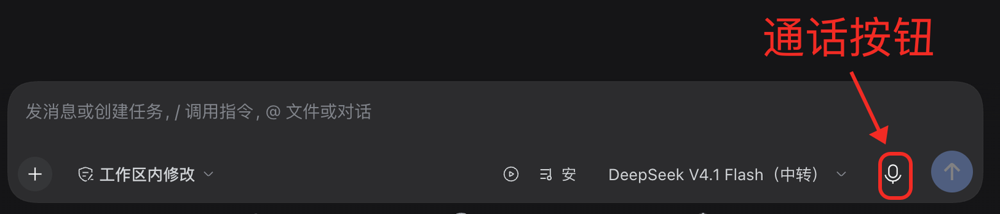
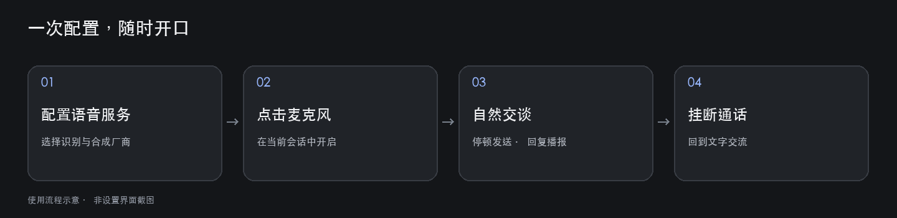

# 语音通话 · Voice call

**在当前 DSH 会话里直接开口，听 Agent 回答。**

不必每句话都点击发送：开启麦克风后，插件自动识别发言、发送文字，并把回复读出来。你可以继续使用标准模式及当前会话的模型、工具和权限，无需切换到另一个 Agent 预设。

[English](README.md) · [npm 包](https://www.npmjs.com/package/voice-call) · [GitHub](https://github.com/crease123/voice-call) · [发行版本](https://github.com/crease123/voice-call/releases)



*真实使用界面。截图已裁掉整个左侧栏，移除工作区、会话列表和账号信息。图中的模型名称是示例，不是使用本插件的前提。*

## 能做什么

| 功能 | 使用体验 |
| --- | --- |
| 连续语音对话 | 说完后稍作停顿，自动转写并发送；回复按句流式播报 |
| 说话打断 | Agent 播报时可以开口打断，再提出新问题 |
| 自由搭配语音服务 | 识别（ASR）与合成（TTS）分别选择 DeepSeek 或豆包，支持混用 |
| 简洁的通话界面 | 通话时收起输入框，显示五段声条、当前状态和挂断按钮；麦克风声量驱动声条变化 |
| 可调音色与收音 | 选择音色、调节播放音量、试听，并调整打断灵敏度和最短持续说话时间 |
| 专用通话规则 | 通话期间自动向模型加入简短、自然的表达要求；挂断后撤回，规则可编辑 |

## 三步开始

### 1. 安装插件

需要 **DSH 0.2.2-rc.1 或更新的 0.2.x 版本**，以及可用的麦克风和音频输出。

在 DSH 中打开 **插件 → 添加插件**，以 npm 包名添加：

```text
voice-call
```

请核对源码仓库为 **`crease123/voice-call`**，避免安装其他作者的相似名称插件。安装并启用后，应能在会话输入区看到麦克风，在设置中看到“语音通话”和“通话提示词”。

也可以从 [GitHub Releases](https://github.com/crease123/voice-call/releases) 获取预构建安装包，在 DSH 中按安装包地址添加。无需下载源码或自行编译。

<details>
<summary>CLI 用户的安装方式</summary>

```sh
dsh plugin --profile <你的-profile> add voice-call
```

把 `<你的-profile>` 换成实际配置名称。Desktop 用户建议直接通过应用内插件管理器安装。

</details>

> 本指南对应 v0.3.3 及更新版本：语音通话直接在现有会话中使用，不再提供独立 Agent 预设。旧版用户请先更新插件。

### 2. 配置自己的语音服务

打开 **设置 → 语音通话**，分别选择“语音识别服务”和“语音合成服务”。识别负责把你的声音转成文字，合成负责把 Agent 的回复转成声音；这两个选择不会替换当前会话的聊天模型。

| 选择 | 需要准备什么 | 如何配置 |
| --- | --- | --- |
| DeepSeek（默认） | 你自己的 DeepSeek API Key，以及对应服务的可用额度/权限 | 复用 DSH 已保存的 `DEEPSEEK_API_KEY`，无需在插件中重复输入 |
| 豆包 / 火山引擎 | 自己的语音服务凭据，并开通所用 ASR/TTS 资源 | 在本页“豆包 API 配置”填写 **API Key**，或旧控制台的 **App ID + Access Token**，然后点击“应用” |

豆包的两种凭据方式任选一种即可，**API Key 优先**。API Key 显示“未配置”，但 App ID 和 Access Token 都显示“已配置”时，仍可使用旧凭据方式。

已保存的密钥不会回显；输入框留空会保留原值。凭据保存在你自己的 DSH 宿主凭据库中，插件不提供共享密钥，也不包含作者的账号或额度。语音服务的使用费用由你自己的服务商账号承担。

选好音色后先“应用”，再用“试听”检查声音；更换厂商后请挂断并重新开始通话。DeepSeek 提供 Stella、Tide 音色；语速、音调和语气调节仅对豆包生效。

### 3. 点击麦克风，开始说话

打开一个普通会话，点击输入区右下角的麦克风。首次使用时，允许 DSH 或浏览器访问麦克风。看到“正在聆听”后即可讲话。



*箭头标出的麦克风是开始通话的按钮，不是右侧的发送按钮。*



说完一句后稍作停顿，插件会自动识别并发送。Agent 回答时会播放语音，你也能在会话里查看文字。需要换个问题时可以开口打断；结束时点击 **挂断语音通话**，即可回到文字输入。通话前尚未发送的文字草稿会保留。

## 调成适合你的通话方式

### 音色、音量与收音

在 **设置 → 语音通话** 中调整：

- **播放音量**：只影响当前客户端的语音播放，不改变系统音量。
- **打断灵敏度**：环境杂音容易误触发时，降低灵敏度；轻声说话不易触发时，提高灵敏度。
- **最短持续说话时间**：适当增加可过滤短促噪声；设置过长可能漏掉很短的发言。
- **试听**：检查当前声音效果。试听期间会暂停当前通话的收音和自动播报，结束后恢复。

建议使用耳机，减少扬声器声音被麦克风再次收录。

### 只在通话期间生效的提示词

打开 **设置 → 通话提示词**，编辑通话规则并保存，例如：

> 先回答核心问题，每次尽量用 1–3 句自然口语。需要展示代码或长列表时留在文字中，口头只说结论。

规则从下一次模型请求生效，不会修改正在生成中的回答。它适用于任意正在通话的会话；挂断或断连后撤回，不会替换原会话的人设、工具和权限。插件不再增加独立的 Personal Agent / Voice call 预设。

## 常见问题

| 遇到的问题 | 先检查这里 |
| --- | --- |
| 安装后没有麦克风按钮 | 确认插件已启用、DSH 版本匹配；重新打开应用再检查 |
| 提示麦克风不可用 | 检查系统和浏览器权限、输入设备；Web 端需在支持 AudioWorklet 的浏览器及安全上下文中使用 |
| 能识别，但没有声音 | 确认 TTS 厂商凭据、播放音量和输出设备，先尝试“试听” |
| 有声音，但识别失败 | 检查 ASR 的凭据、服务开通情况和网络；ASR 与 TTS 可以使用不同厂商 |
| 环境噪声频繁打断 | 使用耳机，降低打断灵敏度或增加最短持续说话时间 |
| 回复还是很长 | 检查“通话提示词”是否保存，并确认请求发生在通话连接后；已有的生成过程不会被追溯修改 |
| 挂断后任务还在运行 | 挂断结束的是语音连接；要停止 Agent 工作，请使用会话自身的停止操作 |

识别和合成依赖网络与服务商响应。DeepSeek 识别在一段发言结束后上传完整音频；“连续通话”不代表逐字实时转写。

## 开发与实现

普通用户安装 `voice-call` 即可，主发行包包含所需的三个自有运行组件。

| 内部组件 | 职责 |
| --- | --- |
| `voice-speech-doubao` | DeepSeek / 豆包识别与合成、凭据读取和语音设置 |
| `personal-agent`（历史内部名称） | Session 通话状态与提示词注入；不再注册 preset，旧基础人设配置不再生效 |
| `client-ui-voice-conversation` | 录音、自动断句、播放、打断及通话界面 |
| `voice-conversation-bundle` | 将运行组件组合为一个可安装插件 |

源码构建需要匹配的 Harness checkout：先在 Harness 中执行 `pnpm run build:artifacts`，然后在本仓库执行：

```sh
pnpm install
DSH_HARNESS_ROOT=/absolute/path/to/deepseek-harness pnpm run build
```

本地监听使用 `pnpm run dev:watch`，同样需要设置 `DSH_HARNESS_ROOT`。源码入口必须配置在 profile 自有 `cordis.patch.yml` 中，才能持久保存插件设置。Remote 元数据生成会暂时修改 Harness 构建配置，请勿与修改该配置的任务并行运行。

更多说明：[语音子系统](docs/voice-conversation.zh.md) · [通话上下文](packages/experimental/personal-agent/README.zh.md) · [组合包](packages/experimental/voice-conversation-bundle/README.zh.md)。

MIT License。请勿向仓库、Issue 或截图提交 API Key、Token 等凭据。
